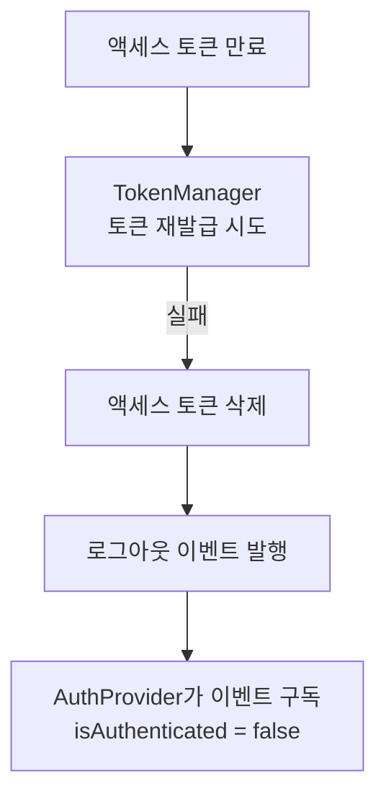

안녕하세요. **Rilog.의 프론트엔드 파트 아지**입니다.

로그인이 필요한 기능이 늘어나면 로그인 모달을 여는 코드도 자연스럽게 늘어납니다. 처음에는 각 컴포넌트에서 모달을 직접 렌더링하면 충분하지만, 어느 순간부터 인증 상태를 확인하고 모달을 여는 로직이 여러 곳에 반복되기 시작하는데요.

Rilog.에서도 비슷한 고민을 했습니다. 로그인 모달을 전역으로 옮기는 것에서 시작했지만, 구현을 이어갈수록 단순히 모달의 위치만 바꿔서는 해결되지 않는 문제가 보였어요. HTTP 클라이언트와 API 함수, 인증 상태, 로그인 모달은 각각 어디까지 책임져야 하는지도 함께 정해야 했습니다.

이 글에서는 로그인 모달의 렌더링 위치를 하나로 모으고, 다시 로그인 필요 액션의 진입점을 좁혀간 과정을 소개합니다. 토큰 재발급의 세부 구현보다는 각 모듈이 어떤 책임을 가져야 자연스럽게 연결되는지에 집중해 볼게요.

## 가장 단순한 로그인 모달에서 시작하기

로그인 모달을 가장 단순하게 구현한다면 모달이 필요한 컴포넌트에서 열림 상태를 관리하고 직접 렌더링할 수 있습니다.

비로그인 사용자가 좋아요 버튼을 누르면 로그인 모달을 보여준다고 가정할게요.

```tsx
export default function PostActions() {
  const [isLoginModalOpen, setIsLoginModalOpen] = useState(false);
  const { isAuthenticated } = useAuth();

  const handleLike = () => {
    if (!isAuthenticated) {
      setIsLoginModalOpen(true);
      return;
    }

    likePost();
  };

  return (
    <>
      <Button onClick={handleLike}>좋아요</Button>

      <LoginModal
        open={isLoginModalOpen}
        onClose={() => setIsLoginModalOpen(false)}
      />
    </>
  );
}
```

모달을 사용하는 곳이 한 군데라면 이 방식으로도 충분합니다. 모달을 여는 조건과 실제 UI가 같은 컴포넌트에 있어 동작을 따라가기도 쉬워요.

문제는 로그인 모달이 특정 페이지에만 속한 UI가 아니라는 점입니다.

현재 Rilog.에서는 사이드바와 모바일 헤더의 로그인 버튼에서 로그인 모달을 사용합니다. 앞으로 좋아요나 댓글 작성처럼 로그인한 사용자에게만 허용되는 액션이 추가되면 모달을 열어야 하는 지점은 더 늘어나요.

호출부마다 모달을 직접 렌더링하면 다음 코드도 함께 반복됩니다.

* 모달의 열림 상태
* 로그인 모달 렌더링
* 로그인 여부 확인
* 비로그인 상태에서 원래 액션을 중단하는 분기

처음에는 이 반복을 없애기 위해 로그인 모달을 전역으로 옮기려고 했습니다. 그런데 구현을 이어가면서 모달의 렌더링 위치를 하나로 만드는 것과 로그인 흐름의 진입점을 하나로 만드는 것은 서로 다른 문제라는 사실을 알게 됐어요.

## 모달의 렌더링 위치를 하나로 만들기

Rilog.에서는 모달의 열림 상태를 관리하고 로그인 모달을 한 번만 렌더링하는 `LoginModalProvider`를 만들어 루트 레이아웃에 배치했습니다.

```tsx
export default function RootLayout({
  children,
}: Readonly<{ children: ReactNode }>) {
  return (
    <html lang="ko">
      <body>
        <AuthProvider>
          <LoginModalProvider>
            {children}
          </LoginModalProvider>
        </AuthProvider>
      </body>
    </html>
  );
}
```

`LoginModalProvider`의 실제 구현에서 핵심 부분만 추리면 다음과 같아요.

```tsx
export default function LoginModalProvider({
  children,
}: LoginModalProviderProps) {
  const [isOpen, setIsOpen] = useState(false);
  const [isLoginPending, setIsLoginPending] = useState(false);

  const login = useCallback(() => {
    setIsLoginPending(false);
    setIsOpen(true);
  }, []);

  const close = useCallback(() => {
    setIsLoginPending(false);
    setIsOpen(false);
  }, []);

  return (
    <LOGIN_MODAL_CONTEXT.Provider value={login}>
      {children}
      <LoginModal
        open={isOpen}
        onClose={close}
        onGitHubLogin={handleGitHubLogin}
        isPending={isLoginPending}
      />
    </LOGIN_MODAL_CONTEXT.Provider>
  );
}
```

하위 컴포넌트는 `useLoginModal`을 통해 모달을 여는 함수를 가져올 수 있습니다.

```tsx
export const useLoginModal = () => {
  const login = useContext(LOGIN_MODAL_CONTEXT);

  if (login === null) {
    throw new Error(
      'useLoginModal은 LoginModalProvider 안에서 사용해야 합니다.',
    );
  }

  return login;
};
```

이제 각 페이지나 컴포넌트가 `LoginModal`을 직접 렌더링할 필요는 없어요.

```tsx
const login = useLoginModal();

return <Button onClick={login}>로그인</Button>;
```

여기까지 구현하면 로그인 모달의 상태와 렌더링 위치는 하나로 모입니다.

하지만 "어떤 상황에서 로그인 모달을 열어야 하는가"라는 판단은 여전히 각 기능에 남아 있어요.

```tsx
const { isAuthenticated } = useAuth();
const login = useLoginModal();

const handleLike = () => {
  if (!isAuthenticated) {
    login();
    return;
  }

  likePost();
};
```

모달은 하나가 됐지만 로그인 여부를 확인하고 액션을 분기하는 코드는 여러 호출부로 퍼질 수 있습니다.

전역으로 관리하고 싶었던 것은 모달의 상태만이 아니었어요. 정확히는 **로그인이 필요한 사용자 액션의 처리 방식**이었습니다.

## 모달이 아니라 로그인 필요 액션을 추상화하기

이를 위해 만든 진입점이 `useAuthAction`입니다.

```tsx
interface UseAuthActionOptions {
  action?: () => void;
}

export const useAuthAction = ({
  action,
}: UseAuthActionOptions = {}) => {
  const { isAuthenticated } = useAuth();
  const login = useLoginModal();

  return useCallback(() => {
    if (!isAuthenticated) {
      login();
      return;
    }

    action?.();
  }, [action, isAuthenticated, login]);
};
```

`isAuthenticated`는 로그인과 토큰 만료에 따라 동기화되며 현재 사용자의 인증 상태를 나타내요.

`useAuthAction`은 이 인증 상태에 따라 다음 행동을 결정합니다.

1. 로그인하지 않았다면 원래 액션을 실행하지 않고 로그인 모달을 엽니다.
2. 로그인했다면 전달받은 액션을 실행합니다.

로그인이 필요한 기능에서는 다음과 같이 사용할 수 있어요.

```tsx
const handleLike = useAuthAction({
  action: likePost,
});

return <Button onClick={handleLike}>좋아요</Button>;
```

호출하는 컴포넌트는 로그인 모달의 상태나 렌더링 위치를 알 필요가 없습니다. `isAuthenticated`를 직접 확인하거나 `useLoginModal`을 함께 호출할 필요도 없어요.

현재 Rilog.에서 실제로 로그인 모달을 여는 곳은 사이드바와 모바일 헤더의 로그인 버튼인데요.

사이드바에서는 다음과 같이 사용합니다.

```tsx
export default function GuestSidebarFooter() {
  const handleLoginClick = useAuthAction();

  return (
    <footer>
      <Button
        aria-label="로그인"
        onClick={handleLoginClick}
      >
        로그인
      </Button>
    </footer>
  );
}
```

이 경우 로그인하고 실행할 별도 액션이 없어, `action`을 전달하지 않습니다. 비로그인 상태라면 로그인 모달을 열고, 인증 상태라면 추가 동작을 하지 않아요.

모바일 헤더의 로그인 버튼도 같은 진입점을 사용합니다.

```tsx
const handleLoginClick = useAuthAction();

return (
  <Button onClick={handleLoginClick}>
    로그인
  </Button>
);
```

아직은 명시적인 로그인 버튼에서만 사용하지만, 이후 좋아요나 댓글 작성 같은 로그인 필요 액션이 추가되면 같은 진입점을 사용할 수 있습니다.

```tsx
const handleCommentSubmit = useAuthAction({
  action: submitComment,
});
```

따라서 `useAuthAction`은 현재 모달 호출을 정리하기 위한 훅인 동시에, 앞으로 추가될 로그인 필요 액션이 통과할 공통 경계가 됩니다.

현재 구현은 비로그인 상태에서 액션을 중단하고 로그인 모달을 여는 역할까지만 담당합니다. 로그인 성공 후 중단했던 액션을 자동으로 다시 실행하는 기능은 아직 포함하지 않았어요.

필요해진다면 이후 다음과 같은 정책을 이 경계에 추가할 수 있습니다.

* 로그인 성공 후 원래 액션 재개
* 어떤 액션에서 로그인을 요구했는지 기록
* 로그인 진행 중 중복 액션 방지
* 로그인 완료 후 돌아갈 위치 보존

이런 정책이 추가되더라도 각 좋아요 버튼과 댓글 폼을 개별적으로 수정하는 대신 로그인 액션의 진입점에서 일관되게 처리할 수 있습니다.

## 그냥 401에서 로그인 모달을 열면 안 될까?

`useAuthAction`을 구현하면서 들었던 의문입니다. 로그인 모달이 필요한 상황은 결국 인증되지 않은 요청에서 시작되니, 그냥 401 응답을 받았을 때 모달을 열면 되지 않을까요?

모든 API 요청이 공통 `ky` 인스턴스를 통과하므로 이곳에서 401을 감지하면 로그인 모달의 진입점을 더 확실하게 하나로 만들 수 있을 것 같았어요.

```text
API 요청
→ 401 응답
→ 로그인 모달 열기
```

하지만 다시 살펴보니 `useAuthAction`과 401 응답 처리는 출발점부터 달랐습니다.

### 401은 사용자의 의도를 설명하지 못해요

두 방식은 판단하는 시점부터 다릅니다. `useAuthAction`은 사용자가 버튼을 누른 순간 `isAuthenticated`를 확인하고, HTTP 요청을 보내기 전에 원래 액션을 실행할지 로그인 모달을 열지 결정해요.

```
사용자 액션
→ isAuthenticated 확인
→ 액션 실행 또는 로그인 모달 열기
```

반면 401은 이미 요청을 보낸 뒤 서버가 반환한 결과입니다.

```text
API 요청
→ 서버 응답
→ 401 처리
```

처음에 이 둘을 헷갈렸던 이유는 `isAuthenticated`가 결국 인증 실패 결과를 반영하기 때문이었습니다. Rilog.에서는 `TokenManager`가 토큰을 관리하다가, 만료된 토큰을 재발급하지 못하면 토큰을 지우고 로그아웃 이벤트를 발행해요. `AuthProvider`는 이 이벤트를 받아 `isAuthenticated`를 `false`로 바꿉니다.



`useAuthAction`은 401 응답을 직접 다루지 않고, 버튼을 누른 순간의 `isAuthenticated` 값만 보고 다음 행동을 고릅니다. 반면 401은 재발급으로 복구될 수 있는 중간 단계의 실패일 수 있어요. 액세스 토큰이 만료되어 난 401은 `TokenManager`가 사용자 모르게 복구하기도 하는데, 이 시점에 모달을 열면 사용자의 의도와 무관하게 화면을 가로막게 됩니다.

### `ky`가 로그인 모달까지 알아야 할까?

401 응답에서 곧바로 모달을 열려면 공통 `ky` 인스턴스에 모달 호출 로직을 연결해야 합니다. 전역 이벤트를 발행하거나 콜백을 주입하면 React 바깥의 `ky`에서도 모달을 열 수 있어요. 다만 이러면 언제 로그인 UI를 띄울지를 HTTP 클라이언트가 결정하게 됩니다.

원래 `ky` 인스턴스가 맡던 일은 명확했어요. 요청 헤더에 액세스 토큰을 넣고, 만료되면 재발급해서 다시 요청하고, 그래도 실패하면 에러를 호출부로 던지는 것까지였습니다.

여기에 모달을 더하면 `ky`는 방금 실패한 요청이 어떤 맥락에서 나왔는지까지 알아야 해요. 같은 조회 API를 어떤 화면에서는 초기 렌더링에, 다른 화면에서는 버튼 클릭에 쓴다면, `ky`는 두 호출을 구분할 수 없습니다. 구분하려면 호출마다 `shouldOpenModalOn401` 같은 옵션을 넘겨야 하고, 그러면 네트워크 계층이 UI의 사정을 알게 돼요.

그래서 Rilog.에서는 401 처리와 모달 호출을 엮지 않았습니다. `ky`는 토큰 재발급과 에러 전달까지만 맡고, 로그인 모달은 사용자가 액션을 시도하는 시점에 `useAuthAction`이 열도록 역할을 나눴어요.

## 각 모듈은 어디까지 책임져야 할까?

결국 “401에서 모달을 열 것인가”라는 고민은 로그인 모달 하나의 문제가 아니었습니다. HTTP 클라이언트, API 함수, 인증 상태와 사용자 액션 중 어느 모듈이 어떤 판단을 내려야 하는지 정하는 문제였어요.

각 모듈의 역할과 경계를 표와 흐름도로 정리하면 다음과 같아요.

| 모듈                        | 책임                                             |
| ------------------------- | ---------------------------------------------- |
| HTTP 클라이언트 (`kyInstance`) | 액세스 토큰 첨부, 복구 가능한 인증 실패의 재발급과 요청 재시도, 최종 오류 전달 |
| `TokenManager`            | 액세스 토큰의 수명 주기 관리, 로그인·로그아웃 이벤트 발행              |
| `AuthProvider`            | 인증 이벤트를 React의 `isAuthenticated` 상태로 제공        |
| API 함수                    | 리소스별 요청을 수행하고 응답과 오류를 호출부에 전달                  |
| `useAuthAction`           | 인증 상태에 따라 원래 액션을 실행하거나 로그인 흐름을 시작              |
| `LoginModalProvider`      | 로그인 모달의 열림 상태와 OAuth 시작 흐름 관리                  |
| `LoginModal`              | 로그인 UI와 사용자 상호작용 표현                            |

```mermaid
flowchart TB
    subgraph Network ["네트워크 & 토큰 계층"]
        ky["HTTP 클라이언트 (kyInstance)"]
        tm["TokenManager"]
        api["API 함수"]
        api --> ky
        ky -->|재발급 실패 시 토큰 삭제| tm
    end

    subgraph State ["인증 상태 계층"]
        auth["AuthProvider (isAuthenticated)"]
        tm -->|로그인·로그아웃 이벤트 발행| auth
    end

    subgraph UI ["사용자 액션 & UI 계층"]
        action["useAuthAction"]
        modalProvider["LoginModalProvider"]
        modal["LoginModal"]

        auth -->|인증 상태 참조| action
        action -->|인증됨: 원래 액션 실행| api
        action -->|비인증: login() 호출| modalProvider
        modalProvider --> modal
    end
```

이렇게 나누고 나니 중앙화의 대상도 분명해졌습니다.

HTTP 클라이언트와 `TokenManager`는 인증 상태를 복구하고 전환합니다. `AuthProvider`는 그 결과를 UI에서 사용할 수 있는 상태로 제공해요. `useAuthAction`은 인증 상태와 사용자 액션을 연결하고, 로그인 모달은 요청받았을 때 UI를 보여줍니다.

API 함수 역시 로그인 모달을 직접 열지 않습니다.

API 함수의 역할은 특정 리소스에 대한 요청을 수행하고 응답이나 오류를 호출부에 전달하는 것입니다. 여기에서 로그인 모달을 열기 시작하면 네트워크 요청 코드가 React UI에 의존하게 돼요. 동일한 API를 다른 화면이나 서버 환경에서 재사용하기도 어려워지고, 무엇보다 API 함수는 그 요청이 어떤 사용자 행동에서 시작됐는지 알지 못합니다.

따라서 인증과 관련된 모든 모듈이 로그인 모달을 호출하게 만들기보다, 로그인 모달 호출이 필요한 사용자 액션을 `useAuthAction`으로 모았습니다.

## 마치며

처음에는 그저 컴포넌트마다 반복되는 `<LoginModal/>`과 `useState`를 줄여보겠다는 가벼운 마음으로 시작했습니다. 하지만 막상 코드를 정리하고 나니 "그래서 이 모달을 언제, 누가 열어야 하지?”하는 질문이 생겼어요.

단순히 반복되는 코드를 줄이는 것의 문제가 아니라 역할과 책임의 경계를 세우는 문제였던 거죠.

이 글을 처음 쓰기 시작했을 때만 해도 `useAuthAction`은 로그인 버튼에만 연결된 작은 훅이었지만, 지금은 글쓰기 버튼과 댓글 작성 버튼에서도 같은 훅을 사용하고 있는데요. 로그인 후 원래 하려던 작업을 이어가고 어떤 화면에서 진입했는지 기록하는 로직이 추가됐을 때도, 변화는 여러 컴포넌트나 HTTP 클라이언트로 흩어지지 않고 `useAuthAction` 안에서 정리됐습니다.

여러분의 로그인은 어떻게 설계되어 있나요?
지금 내 프로젝트의 인증 로직은 사용자의 의도와 서버의 응답을 우아하게 분리하고 있는지, 오늘 밤 가볍게 코드를 열어보는 건 어떠신가요?
