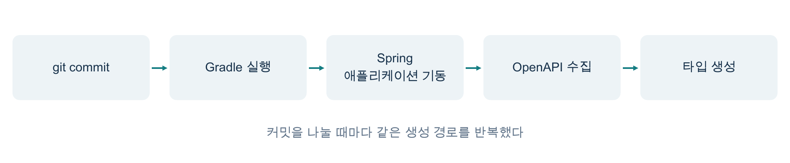
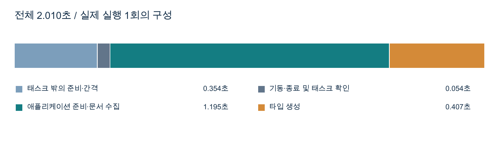
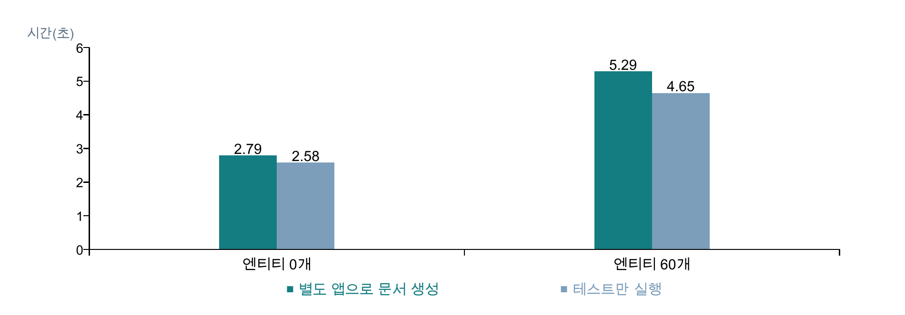
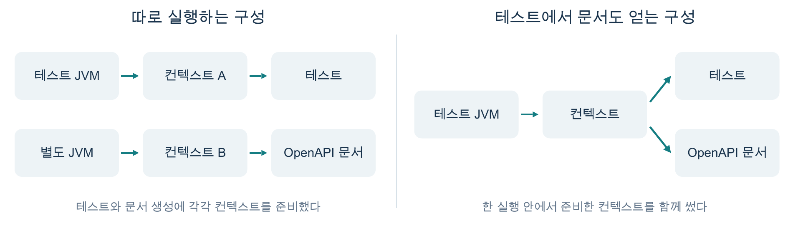
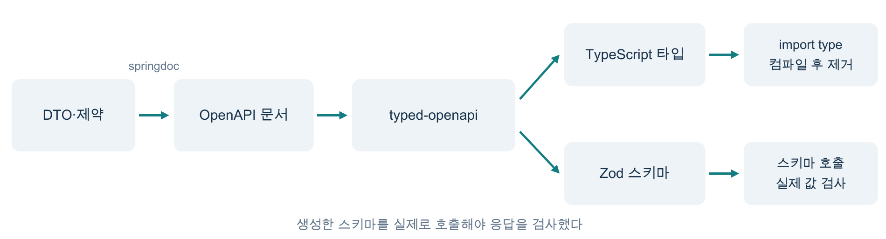
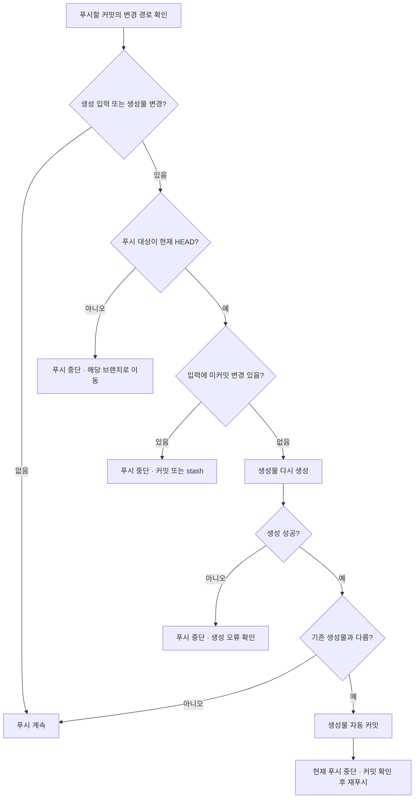

# 포기하자고 설득하려다 설득당한 이야기

*Spring OpenAPI 타입 자동 생성을 없애려다 유지한 이유*

Spring 백엔드와 TypeScript 프런트엔드가 API 타입을 공유하는 팀에서 겪은 이야기다. 백엔드의 요청·응답 구조를 OpenAPI 문서로 만들고, 그 문서에서 프런트엔드가 쓸 TypeScript 타입을 자동으로 생성했다. 그런데 문서를 얻으려면 Spring 애플리케이션을 실행해야 해서 커밋할 때마다 서버가 준비되기를 기다렸다.

한 번만 몇 초 기다렸다면 대수롭지 않게 넘겼을 것이다. 그런데 커밋을 작게 나눌수록 같은 작업을 기다리는 횟수도 늘었다. Java 프로젝트에서 타입을 만들려고 Node.js까지 실행하는 구성도 마음에 걸렸다. Windows에서는 Gradle이 `npx.cmd`를 찾지 못해 커밋이 막힌 적도 있었다. 타입을 다시 적는 수고를 덜었지만 도구를 관리하고 기다리는 일은 늘었다.

그래서 자동 생성을 없애고 프런트엔드에서 타입을 직접 작성하는 편이 간단하지 않을까 생각했다. 다만 불편하다는 이유만으로 이미 쓰던 방식을 걷어내자고 말하기는 어려웠다. 어느 구간에서 얼마나 기다렸는지 재면 설득할 근거를 얻을 것 같았다.

측정을 마친 뒤에는 반대로 자동 생성을 유지하는 쪽을 택했다. Node.js가 느릴 것이라는 예상은 빗나갔다. 생성기의 언어를 바꾸기보다 실행 시점과 애플리케이션을 띄우는 횟수를 조정하는 편이 효과적이었다. 타입만 생각하며 시작했던 작업도 프런트엔드의 검증 규칙까지 함께 살피는 일로 커졌다.

## 타입을 두 번 쓰지 않으려고 붙인 자동화였다

백엔드 DTO와 프런트엔드 타입은 서로 다른 언어로 같은 API 계약을 표현했다. 백엔드에서 필드를 추가하거나 이름·필수 여부를 바꾸면 그 내용을 알리고 프런트엔드 타입에도 옮겨 적어야 했다.

같은 내용을 두 번 적는 수고보다 변경을 놓쳤을 때가 더 신경 쓰였다. 예를 들어 서버가 필드 이름을 바꿔도 프런트엔드의 타입 선언과 코드에 예전 이름이 함께 남아 있으면 TypeScript는 오류를 찾지 못한다. 실제 응답은 달라졌는데 컴파일은 통과하므로 타입을 맞췄다고 생각하기 쉽다. 그래서 사람이 두 정의를 계속 맞춰야 했다.

이 중복을 줄이려고 Spring Boot 프로젝트에 springdoc을 붙였다. springdoc이 만든 `openapi.json`을 `openapi-typescript`에 넣으면 TypeScript 타입 선언을 얻을 수 있다. 프런트엔드는 생성물을 가져다 쓰고 API 계약이 바뀌면 생성물을 다시 만들도록 했다. 생성물이 저장소에 남아 있으면 프런트엔드 개발자가 매번 Spring 애플리케이션을 실행하지 않아도 타입을 사용할 수 있었다.

다만 생성기는 문서에 적힌 계약을 옮겼으므로 문서부터 실제 서버 동작과 맞아야 했다. 자동 생성으로 양쪽에서 필드 정의를 반복해서 쓰는 일은 줄이려 했지만 서버 응답의 정확성까지 생성기에 맡기지는 않았다. 이 차이는 나중에 Zod로 실제 응답을 검사하면서 더 구체적으로 드러났다.

초기에는 오래된 생성물을 커밋하지 않도록 `pre-commit`에서 매번 다시 만들었다. 커밋을 누르면 Gradle이 별도 Spring 애플리케이션을 실행해 OpenAPI 문서를 받고 Node.js 도구로 TypeScript 타입을 만들었다.



처음에는 API 코드를 바꾼 커밋에 타입도 함께 넣으면 갱신을 빠뜨릴 일이 줄어들 것 같았다. 하지만 작업을 이어 가며 커밋을 잘게 나누자 생성 시간이 계속 끼어들었다. 처음 남긴 측정 기록에서는 예열한 상태에서도 애플리케이션을 띄워 OpenAPI 문서를 얻는 경로에 약 4.9초가 걸렸다. 기능을 나눠 커밋할 때마다 같은 4.9초를 다시 기다렸다.

어느새 나는 자동 생성의 이점보다 훅이 끝나기를 기다리는 시간을 더 자주 생각했다. Java 프로젝트인데 Node.js까지 있어야 한다는 점도 그 불편을 키웠다. 도구가 하나 늘었다는 사실과 실행이 느리다는 인상을 한데 묶었고 Node.js를 빼면 구성이 가벼워질 것이라고 예상했다.

## 시간을 나누어 재자 의심하던 곳이 달랐다

처음에는 자동 생성을 계속 쓸지만 고민했지만 실행 경로를 살펴보니 여러 결정을 나눠 검토해야 했다. 애플리케이션을 띄우는 방식과 생성기의 종류, 생성 시점, 생성물 커밋 여부에 따라 드는 비용이 달랐다. 어느 하나가 불편하다고 해서 나머지까지 함께 포기할 필요는 없었다.

그래서 Gradle 실행부터 Spring 애플리케이션 기동, 문서 수집, 타입 생성까지 커밋 시간을 나누어 확인했다. 전체가 느리다는 이유만으로 Node.js를 원인으로 지목하면 생성기를 바꿔도 대부분의 대기가 남을 수 있었다.

본문의 수치는 아래처럼 서로 다른 실험에서 얻었다. 같은 실험 안에서도 측정 범위를 구분했으며 기존 기록과 추가 샘플을 개선 전후로 비교하지 않았다.

| 측정 구분 | 입력과 구성 | 측정 범위·결과 | 반복 횟수 | 장비·실행 환경 |
| --- | --- | --- | --- | --- |
| 기존 문서 생성 | 당시 프로젝트, 세부 구성 미기록 | 애플리케이션 실행·문서 수집 경로 약 4.9초 | 1회 | 예열 상태, CPU·OS·JDK 미기록 |
| 기존 커밋 전체 | API 100개, JPA·Spring Security 포함 여부 미기록 | 커밋 전체 7.9초, 그중 `npx` 0.61초 | 1회 | CPU·OS·JDK 미기록 |
| 기존 생성기 비교 | 같은 OpenAPI 문서를 두 생성기에 입력, 세부 규모 미기록 | Java 0.53초, Node.js 0.95초 | 각 1회 | CPU·OS·JDK 미기록 |
| 기존 규모 증가 | 합성 컨트롤러·엔티티 0~60개, Spring Security·연관관계·쿼리 메서드 300개·서비스 계층 포함 | 별도 문서 생성 2.79→5.29초, 테스트 2.58→4.65초, 테스트에 문서 생성 추가 시 0.43초 증가 | 조건별 1회 | CPU·OS·JDK 미기록 |
| 추가 샘플 | GET API 100개·DTO 스키마 10개, JPA·Spring Security 제외 | 전체 생성 2.010초, 타입 생성 태스크 0.400초, 생성기 단독 실행 0.379초·0.245초 | 예열 후 각 5회, 중앙값 | Apple M4·macOS 27.2·arm64·JDK 21.0.9·Node.js 24.11.1·Gradle 9.2.1 |

4.9초는 문서 생성 경로, 7.9초는 타입 생성과 기타 작업까지 포함한 커밋 전체 시간이다. 서로 다른 측정 기록이라 두 값을 빼서 구간별 시간을 계산할 수는 없다. 추가 샘플의 도구 버전과 실행 방법은 아래에서 설명한다.

기존 기록에서 커밋 한 번에는 총 7.9초가 걸렸다. 이 중 `npx` 실행은 0.61초로 전체의 약 7.7%였다. Node.js를 없애면 기다림도 크게 줄 것이라고 예상했지만 전체 시간의 작은 일부만 보고 있었다. 나머지 7.29초는 원시 로그가 없어 구간별로 나눌 수 없었다. 그래도 생성기만 바꿔서는 대기의 대부분을 없애기 어렵다는 점은 확인했다.

글을 정리하며 실행 구간을 다시 쟀다. 당시 생성 설정을 참고해 별도 샘플을 만들고 GET API 100개와 DTO 스키마 10개를 넣었다. Spring Boot 4.1.0과 springdoc 3.1.0을 사용했으며 타입 생성기는 `openapi-typescript@7.13.0`으로 맞췄다. JPA와 Spring Security는 넣지 않았다.

추가 측정에서는 의존성을 받은 뒤 한 차례 예열하고 Gradle 데몬과 컴파일 결과를 재사용했다. 다만 이전 문서로 측정을 대신하지 않도록 매번 OpenAPI 출력 파일을 지웠다. 명령 전체의 경과 시간과 각 Gradle 태스크의 시작·종료를 기록한 뒤, 같은 명령을 다섯 번 실행해 중앙값과 범위를 확인했다.

처음에는 같은 생성 명령을 반복하면 매번 애플리케이션을 새로 실행할 줄 알았다. 그런데 로그에는 `generateOpenApiDocs UP-TO-DATE`가 찍혀 있었다. 이전 출력을 재사용한 시간을 애플리케이션을 실행해 문서를 얻은 시간으로 읽을 뻔했다. 출력을 지우고 다시 측정한 뒤, 다섯 번 모두 문서 생성 태스크가 실행됐는지 로그로 확인했다.

새 샘플의 전체 생성 시간은 중앙값 2.010초였다. 그중 애플리케이션 준비를 기다리고 OpenAPI 문서를 수집한 태스크는 중앙값 1.206초, `npm exec`를 포함한 타입 생성 태스크는 0.400초였다. 같은 문서를 입력해 타입 생성만 단독 실행하면 중앙값 0.379초가 걸렸다.



*이 그래프는 추가 측정에서 전체 시간이 중앙값에 해당한 실행 한 번을 나눈 것이다. 그래프의 각 구간을 더하면 그 실행의 전체 시간이 됐으며 구간별 중앙값을 더한 그림은 아니었다.*

1.206초에는 애플리케이션이 요청을 받을 때까지 기다리는 시간과 최초 문서 생성·HTTP 수집 시간이 함께 들어 있다. 타입 생성 태스크의 0.400초도 Node.js 프로세스와 `npm exec` 실행 비용을 포함한다. 생성기만 단독 실행한 0.379초와 범위가 다르다.

추가 샘플에서도 문서를 얻는 구간이 타입 변환보다 길었다. 생성기의 언어보다 애플리케이션 준비와 문서 수집부터 살펴봐야 했다.

물론 Node.js를 설치하고 버전을 관리하는 부담은 남았다. 실행 시간을 줄여도 Windows에서 실행 파일을 찾지 못한 오류는 따로 해결해야 했다. 다만 설치·실행 환경의 불편과 속도를 분리해 이야기할 수 있게 됐다. Node.js가 있다는 이유로 느리다고 생각했던 판단부터 고쳤다.

## 프로젝트가 커질 때는 문서보다 컨텍스트를 다시 봤다

생성기를 바꿔도 기대만큼 시간을 줄이기 어렵다는 점은 알았지만 프로젝트가 커질수록 대기가 길어질까 봐 걱정됐다. 처음 구성은 작았고 앞으로 컨트롤러와 엔티티, 서비스가 늘어날 예정이었다. 작은 프로젝트에서 버틸 만하다는 사실만으로 이 흐름을 계속 유지해도 괜찮다고 말하기는 어려웠다.

테스트 컨텍스트에서 문서를 만드는 방식은 실제 적용에 앞서 검토한 대안이었다. 기존 실험에서는 합성 컨트롤러와 엔티티를 늘려 가며 시간을 비교했다. Spring Security와 연관관계, 쿼리 메서드 300개, 서비스 계층을 포함한 무거운 구성도 만들었다. 별도 애플리케이션으로 문서를 얻는 경로와 테스트만 실행하는 경로, 테스트 컨텍스트에서 문서를 얻는 경로를 살폈다.

기록에 남은 엔티티 0개와 60개 조건을 비교하면 별도 애플리케이션의 문서 생성은 2.79초에서 5.29초로, 테스트 실행은 2.58초에서 4.65초로 늘었다. 두 경로가 함께 느려졌다.



*기존 기록에 남아 있던 두 지점만 표시했다. 중간 엔티티 수의 측정값은 없어 증가 폭을 선으로 이어 추정하지 않았다.*

이 결과를 보고 증가한 시간을 모두 OpenAPI 문서 생성 탓으로 돌리기는 어려웠다. 테스트만 실행해도 컨텍스트 준비가 무거워졌다. JPA 메타데이터와 빈 준비를 포함해 Spring 컨텍스트를 만드는 시간도 함께 늘었다고 해석했다.

그래서 테스트 때문에 이미 만드는 컨텍스트에서 문서까지 얻으면 얼마나 더 기다릴지 확인하기로 했다. 별도 애플리케이션을 한 번 더 실행하는 경로를 없애면 문서 생성의 부담도 다르게 볼 수 있을 것 같았다.

기존 기록에서는 테스트에 문서 생성을 추가했을 때 0.43초가 늘었다. 0.43초는 문서 생성 경로 전체가 아니라 테스트에서 준비한 컨텍스트에 문서 생성을 더했을 때 늘어난 시간이었다. 테스트까지 실행하지 않는 개발 흐름에 그대로 대입할 수도 없었다. 테스트를 어차피 실행하는 상황에서 얼마나 더 기다리는지를 봐야 했다.

추가 샘플에서도 `@SpringBootTest`와 MockMvc로 컨텍스트만 준비하는 경로와 여기에 `/v3/api-docs` 요청·파일 저장을 더한 경로를 비교했다. 같은 테스트 설정으로 두 경로를 번갈아 다섯 번씩 실행했다.

| 추가 샘플에서 실행한 작업 | 5회 중앙값 | 최솟값~최댓값 |
| --- | ---: | ---: |
| 컨텍스트를 준비하고 테스트만 실행 | 1.528초 | 1.504~1.573초 |
| 같은 테스트에서 문서 요청·저장까지 실행 | 1.694초 | 1.658~1.703초 |
| 테스트 내부의 문서 요청·저장 구간만 측정 | 0.144초 | 0.143~0.149초 |

두 실행 경로의 중앙값 차이는 0.166초였고, 테스트 내부에서 잰 문서 요청·저장은 중앙값 0.144초였다. 전자는 명령 전체의 차이, 후자는 테스트 내부의 한 구간이므로 측정 범위가 다르다.

이 실험은 서로 다른 Gradle 명령 사이에 Spring 컨텍스트를 공유한 실험도 아니었다. 각 실행에서는 테스트 JVM과 컨텍스트를 새로 준비했고 그 실행 안에서 준비한 컨텍스트로 문서 요청을 처리했다. Spring의 컨텍스트 캐시는 같은 테스트 프로세스에서 설정이 일치하는 컨텍스트를 재사용한다. 별도 JVM에서 실행한 애플리케이션과는 캐시를 공유하지 못한다.

따라서 테스트를 실행할 때 이 방식을 적용할 이점이 더 컸다. 컨텍스트를 이미 만들어 놓았다면 문서를 얻으려고 다른 애플리케이션을 다시 띄울 필요가 줄었다. 반대로 문서 하나를 만들려고 원래 실행하지 않던 무거운 테스트 전체를 새로 돌린다면 비용이 오히려 커질 수 있었다. 테스트 컨텍스트라는 이름만 보고 선택할 수는 없었다. 기존에 실행하던 작업과 컨텍스트를 함께 쓸 수 있는지 확인해야 했다.



*테스트 실행과 문서 생성이 모두 필요한 경우의 구조를 비교했다. 별도 Gradle 실행 사이에 컨텍스트를 공유한 구성은 아니었다.*

다만 실험에서 확인한 방식을 실제 파이프라인에 적용하지는 않았다. 글을 쓰며 현재 `server/build.gradle`을 다시 확인했을 때도 생성 경로는 `forkedSpringBootRun`으로 별도 애플리케이션을 띄웠다. 테스트 기반 생성은 가능성을 확인한 대안으로 남았다. 실제로 바꾸려면 실행할 테스트의 범위와 설정, 생성물을 저장할 시점까지 함께 정해야 했다.

## Java로 바꾸면 간단해질 줄 알았다

Node.js가 전체 대기의 대부분을 차지하지는 않았지만 Java로 생성기를 통일하면 환경 관리가 쉬워질 것 같았다. 백엔드 개발자는 이미 JDK를 사용하고 있었으므로 별도 도구를 하나 덜 설치할 수 있지 않을까 싶었다. 그래서 Java 기반 OpenAPI Generator도 비교했다.

기존 생성기 비교에서 Java는 0.53초, Node.js는 0.95초가 걸렸다. 앞의 0.61초는 커밋 전체를 측정할 때의 `npx` 실행 시간이므로 이 비교와 구분했다. Java 쪽이 0.42초 빨랐지만 실행 시간보다 생성한 파일의 구성이 더 신경 쓰였다. 당시 옵션으로는 7개 파일, 702줄을 생성했는데 모델만 남기면 `runtime.ts` 참조 때문에 컴파일에 실패했다. 실행 시간을 조금 줄이는 대신 프런트엔드가 함께 관리할 파일과 의존성이 달라졌다.

OpenAPI Generator의 출력은 생성 옵션과 대상 클라이언트에 따라 달라질 수 있다. 당시 프런트엔드에는 타입이 필요했는데, 비교한 출력에서는 모델 파일만 떼어 바로 쓸 수 없었다. 빠르게 생성했다는 사실만으로는 교체할 근거가 부족했다.

생성기는 Spring 코드 대신 springdoc이 만든 OpenAPI 문서를 읽는다. 그래서 백엔드를 Java로 작성했다는 이유만으로 문서 변환 도구도 Java여야 할 필요는 없었다. 같은 JDK에서 실행된다는 편의는 있었지만 어떤 코드를 얼마나 만들고 프런트엔드가 무엇을 가져다 써야 하는지를 함께 비교해야 했다.

그래서 실행 시간, 설치할 도구, 생성물의 크기와 역할을 다른 항목으로 보기 시작했다. 실행 시간이 짧아도 불필요한 클라이언트 코드를 많이 만들면 관리 부담이 늘었다. 반대로 Node.js 의존성을 유지하더라도 필요한 타입과 검증 코드를 얻는다면 받아들일 이유가 있었다. 어느 언어로 실행되는지를 첫 번째 기준으로 삼았던 순서를 바꿨다.

추가 샘플에서는 같은 OpenAPI 문서를 `openapi-typescript`와 `typed-openapi@3.2.1`에 넣어 시간과 출력 크기를 확인했다. `typed-openapi`는 TypeScript 타입과 Zod 검증 스키마를 생성하는 도구다. Zod는 실행 중에 실제 값이 스키마에 맞는지 검사한다. 생성기 단독 실행의 중앙값은 각각 0.379초와 0.245초였지만 전자는 타입 선언만, 후자는 Zod 스키마까지 생성했으므로 속도만으로 선택할 수는 없었다.

`openapi-typescript`의 출력은 타입 선언 한 파일로 87,402바이트, 3,690줄이었다. Zod 옵션을 사용한 `typed-openapi`의 출력은 두 파일을 합쳐 84,103바이트, 2,882줄이었다. API 100개가 DTO 스키마 10개를 공유한 입력이었고 도구의 기본 출력에 저장소의 후처리를 적용하지 않은 값이었다. 실제 프로젝트의 출력 크기는 API 수뿐 아니라 DTO 구조와 후처리에 따라서도 달라진다.

타입 선언은 컴파일 후 사라지고, 실행 가능한 코드는 가져오는 방식과 실제 사용에 따라 번들에 포함되는 범위가 달라진다. 따라서 생성 파일의 크기와 프런트엔드 번들 증가량은 따로 비교해야 한다.

## 타입을 맞춘 뒤에는 검증 규칙이 남았다

타입 자동 생성만 유지하면 고민이 끝날 줄 알았지만 프런트엔드는 Zod도 사용하려 했다. 타입을 생성해도 Zod 스키마를 따로 적는다면 같은 필드와 검증 조건을 다시 관리해야 했다.

정적 타입은 응답의 형태를 선언하고 실행 중 검증은 실제로 받은 값이 그 형태에 맞는지 검사한다. 문자열 타입은 개발 중 잘못된 연산을 막는 데 도움이 되지만 외부 응답을 직접 검사하지는 않는다. 그래서 타입 생성만으로는 실제 응답 검증까지 해결하기 어려웠다.

요청 DTO도 문자열 타입만으로는 닉네임의 길이 제한까지 표현할 수 없다. 그래서 `@NotNull`과 `@Size(min = 2, max = 20)`을 붙인 DTO로 Zod 생성 결과를 확인했다.

```java
public record MemberCreateRequest(
    @NotNull @Size(min = 2, max = 20) String nickname,
    String emailAddress
) {}
```

```ts
export const MemberCreateRequest = z.object({
  emailAddress: z.string().optional(),
  nickname: z.string().min(2).max(20)
});
```

서버의 Bean Validation 제약을 문서에 담아 검증 스키마로 만들면 프런트엔드에서 같은 길이 제한을 다시 적는 일을 줄일 수 있었다. 생성기의 언어보다 프런트엔드에 필요한 결과물을 만들 수 있는지가 더 중요해졌다.

`openapi-typescript`는 Zod 생성을 붙인 뒤에 교체했다. 처음에는 기존 `api.d.ts`를 유지하면서 `api.zod.ts`와 이 파일이 참조하는 `api.zod.types.d.ts`를 추가했다. 그런데 `typed-openapi`가 스키마마다 같은 이름의 타입과 상수를 함께 내보냈다. `MemberResponse`라는 이름으로 타입을 가져올 수도 있었고 같은 이름의 Zod 스키마 값을 가져와 `.parse()`를 호출할 수도 있었다.

타입 제공 역할이 겹쳤으므로 `api.d.ts`와 이를 만들던 `generateApiTypes` 태스크를 제거했다. 훅과 CI의 검사 대상에서도 해당 파일을 뺐다. 이후에는 `generateApiArtifacts`를 진입점으로 삼아 OpenAPI 문서와 Zod 생성물 두 파일을 갱신했다. Zod 생성물을 먼저 추가하고 중복된 타입 출력을 나중에 걷어냈다.

이때도 생성 도구의 이름보다 사용 방법을 살폈다. 화면에서 타입만 필요하다면 `import type`으로 가져오고 외부 응답을 검사하는 경계에서는 스키마 값을 가져와 호출하는 식이었다. TypeScript의 타입 표기와 `import type`은 컴파일 후 사라지지만 Zod 스키마는 실행할 코드다. 스키마를 실제로 사용하면 번들 크기와 검증 실행 비용도 고려해야 한다.



Zod 파일이 생겼다고 실제 응답 검증까지 저절로 붙지는 않았다. 기존 프런트엔드는 생성물에서 타입만 가져왔고 `apiGet`은 응답을 `response.json() as Promise<T>`로 간주했다. 이 타입 단언은 받은 값을 검사하지 않으므로 서버 응답이 계약과 달라도 실행 중에 알아챌 수 없었다.

이후 `apiGet`과 `apiPostForm`이 응답 스키마를 받아 검사하도록 바꾸고 API 호출 20곳에 스키마를 연결했다. 예를 들어 브랜드 목록을 받을 때는 `apiGet`에 `BrandOverviewResponse` 스키마를 함께 넘겼다. 개발·스테이징에서는 검증에 실패하면 `INVALID_RESPONSE` 오류를 던졌다. 운영에서는 화면을 막지 않도록 응답을 그대로 사용하면서 어긋난 필드의 경로를 기록했다. 스키마를 만드는 일과 실제 응답 경계에 연결하는 일은 이렇게 나뉘어 있었다.

타입과 Zod 스키마를 생성하기 시작한 시점부터 모든 응답을 검증했다고 쓰기는 어려웠다. 도구를 설치한 시점과 실제 사용한 시점이 달랐고 각 단계에서 얻은 이점도 달랐다.

## 느린 일을 커밋마다 할 필요는 없었다

자동 생성을 계속 쓸 이유를 찾은 뒤에는 실행 빈도를 다시 봤다. API 계약의 변경은 확인해야 했지만 그 검사를 커밋이 끝날 때마다 실행할 필요는 없었다. 여러 커밋을 한 번에 푸시한다면 그때 생성물을 검사하는 방식도 가능했다.

그래서 생성물 검증을 `pre-commit`에서 `pre-push`로 옮겼다. 이후 루트 훅이 서버와 프런트엔드의 하위 훅을 호출하도록 나눴을 때도 서버의 생성물 검증은 푸시 직전에 실행했다. 루트 `pre-push`가 받은 입력을 하위 훅에도 전달해 서버 훅이 실제로 푸시할 커밋의 변경 경로를 판별하도록 했다.

기존 문서 생성 비용 4.9초로 계산하면 차이가 바로 보였다. 커밋 다섯 개를 만든 뒤 한 번 푸시하는 흐름에서는 `pre-commit`이 24.5초를 사용한 반면, `pre-push`에서는 4.9초를 한 번 사용했다. 한 번에 걸리는 시간은 그대로였지만 같은 작업을 반복하는 횟수는 줄었다.

| 작업 흐름 | `pre-commit`에서 생성 | `pre-push`에서 생성 |
| --- | ---: | ---: |
| 커밋 1개를 한 번 푸시 | 4.9초 | 4.9초 |
| 커밋 3개를 모아 한 번 푸시 | 14.7초 | 4.9초 |
| 커밋 5개를 모아 한 번 푸시 | 24.5초 | 4.9초 |

*이 표는 기존 1회 비용으로 계산한 비교다. 커밋을 실제로 연속 실행해 잰 값이 아니며, 관련 변경을 한 번의 푸시로 보낸다고 가정해 계산했다.*

커밋마다 푸시한다면 실행 횟수는 거의 줄지 않았다. 하지만 작은 커밋을 모아 푸시하면 매번 기다리지 않아도 됐으므로 커밋을 작게 나누려던 팀의 작업 방식에 맞았다.

서버와 무관한 변경이라면 생성 경로를 실행할 이유도 적었다. 훅은 푸시할 커밋에서 관련 경로가 바뀌었는지 확인하고 바뀌지 않았다면 생략했다. 기존 기록의 0.06초는 이런 생략 경로의 시간이었으며 네트워크 전송을 포함한 Git 푸시 전체 시간으로 해석하지 않았다.

CI에서만 검사하면 로컬 대기는 줄일 수 있었지만 생성물 불일치를 원격에 보낸 뒤에야 발견하게 됐다. 그래서 원격에서 오류를 확인하고 다시 푸시하는 왕복을 줄이려고 로컬 `pre-push` 검사를 유지했다. 이 프로젝트에서는 커밋을 나누는 작업을 덜 끊으면서 푸시 전에 오류를 발견할 수 있는 시점을 골랐다.

다만 실행 시점을 옮긴 뒤에는 생성물을 갱신하는 방식도 바꿔야 했다. `pre-commit`에서는 생성한 파일을 현재 커밋에 넣는 흐름을 생각할 수 있었지만 `pre-push`가 실행될 때는 보낼 커밋이 이미 정해져 있었다. 훅 안에서 새 커밋을 만들어도 그 커밋이 현재 푸시에 자동으로 포함되지는 않았다. Git은 참조마다 로컬 참조·로컬 커밋 ID·원격 참조·원격 커밋 ID를 한 줄로 묶어 `pre-push`의 표준 입력으로 전달한다. 훅에서 커밋을 추가해도 이미 전달받은 푸시 대상 ID는 바뀌지 않는다.

생성물이 최신 상태가 아닐 때 선택할 동작을 정해야 했다. 검증만 하고 사용자에게 재생성을 맡길지, 생성한 파일을 별도 커밋으로 만들지, 마지막 커밋을 자동으로 고칠지 비교했다. 현재 훅은 생성물을 별도 커밋으로 남기고 이번 푸시를 중단했다. 개발자가 추가된 커밋을 확인한 뒤 다시 푸시하는 흐름을 택했다.



이때 생성기가 검사하는 코드와 원격으로 보낼 커밋이 같은지도 살펴야 했다. 생성기는 작업 트리의 파일을 읽으므로 입력에 미커밋 변경이 있으면 푸시할 커밋과 다른 코드에서 문서를 만들 수 있다. 그래서 관련 입력에 미커밋 변경이 있으면 생성을 시작하기 전에 차단했다.

아래는 실제 서버 훅에서 변경 경로를 읽는 부분과 미커밋 변경을 막는 부분을 발췌한 코드다. `openapi_inputs`는 서버 소스와 Gradle 설정 경로이고, `openapi_watched`는 여기에 생성물 경로까지 더한 목록이다. 첫 블록은 기존 원격 브랜치를 갱신할 때의 분기이며 새 브랜치·삭제·HEAD 확인 등은 생략했다.

```sh
while read -r local_ref local_sha remote_ref remote_sha; do
    # 새 브랜치·브랜치 삭제 처리 생략
    touched=$(git log --format= --name-only "$remote_sha..$local_sha" \
        -- $openapi_watched | head -1)
    if [ -n "$touched" ]; then
        openapi_relevant=1
        # 현재 HEAD와 푸시 대상의 일치 여부 확인 생략
    fi
done
[ "$openapi_relevant" -eq 0 ] && exit 0

if ! git diff --quiet HEAD -- $openapi_inputs ||
    [ -n "$(git ls-files --others --exclude-standard -- $openapi_inputs)" ]; then
    echo "[pre-push] 커밋하지 않은 변경이 있어 생성물을 검증할 수 없습니다."
    exit 1
fi
```

`git log`는 푸시할 커밋 범위에서 감시 대상 경로의 변경을 찾는다. 이어 `git diff`로 추적 중인 입력의 변경을 확인하고 `git ls-files`로 아직 추적하지 않는 입력 파일도 확인한다. 새 브랜치는 다른 원격 브랜치에 없는 커밋을 검사하며 브랜치 삭제는 건너뛴다.

생성 입력뿐 아니라 생성물 자체도 감시해야 했다. 누군가 생성 파일을 손으로 고쳤다면 입력 경로에는 변화가 없어도 생성물은 틀려 있었다. 그래서 생성물도 감시 대상에 넣고 다시 생성한 결과와 비교했다. 직접 수정하지 말자는 규칙을 어긴 파일도 검사에서 잡아내야 했다.

글을 정리하며 현재 훅을 복사해 로컬 bare 원격에 실제로 푸시해 봤다. 입력과 생성물이 맞는 경우, 문서만 손으로 바꾼 경우, 생성물이 오래된 경우, 입력에 미커밋 변경이 있는 경우를 확인했다. 자동 커밋 뒤의 재푸시와 새 브랜치 푸시, 브랜치 삭제, 서버와 무관한 변경, 현재 HEAD가 아닌 참조를 보내는 상황까지 모두 아홉 가지를 실행했다.

훅의 분기만 살피려고 생성기 대신 파일을 복사하는 스텁을 실행했고 아홉 경우 모두 기대한 종료 코드를 얻었다. 이 검증은 훅의 중단·재푸시 동작을 확인한 것으로 실제 Gradle 생성과의 통합이나 다른 운영체제는 검증 범위에 포함하지 않았다.

## 생성물을 남기는 비용까지 없애지는 못했다

실행 시점을 옮긴 뒤에도 생성물을 Git에 커밋하는 비용은 남았다. 기존 실험에서 주문 기능과 결제 기능을 서로 다른 브랜치로 만든 뒤 병합했다. 소스 파일은 겹치지 않았지만 두 기능이 같은 `openapi.json`을 바꿔 문서에서 충돌 7곳이 발생했다.

API 100개를 둔 당시 구성의 생성물은 약 480KB였다. 기능 하나를 바꿔도 큰 생성 파일의 변경이 PR에 함께 들어왔고 서로 다른 기능의 작업이 같은 파일을 건드렸다. 생성 시간을 줄여도 코드 리뷰와 병합의 부담은 남았다. 실행 시간뿐 아니라 생성 파일을 읽고 합치는 수고도 함께 살펴야 했다.

생성물을 커밋하지 않는 방식도 다시 생각했다. 빌드할 때마다 만들면 저장소의 큰 변경과 일부 충돌을 덜 수 있었지만 프런트엔드가 쓸 결과물을 언제, 어느 환경에서 준비할지 달라졌다. 게다가 생성 도구와 서버 실행에 필요한 조건을 더 많은 곳에서 맞춰야 할 수도 있었다. 생성물을 저장소에서 빼더라도 필요한 시점에 다시 만드는 작업은 남았다.

이 프로젝트에서는 생성물을 남기는 쪽을 유지했다. 서버 계약과 프런트엔드가 사용할 출력이 함께 바뀌었는지 검토하고 그 변경 이력을 남길 수 있었다. 다만 생성물의 충돌은 소스 코드와 다른 방식으로 다뤘다. 컨트롤러와 DTO 등 원본을 먼저 병합하고 합쳐진 입력으로 생성물을 다시 만들기로 했다.

생성 파일에서 충돌한 줄만 골라 붙이면 Git의 병합은 끝낼 수 있었다. 하지만 두 브랜치의 API를 모두 반영한 결과인지까지 그 작업만으로 확신하기는 어려웠다. 사람이 원본을 결정하고 생성기는 그 원본에서 출력을 만드는 순서가 관리하기 쉬웠다. 생성물을 저장소에 남기더라도 파일을 직접 편집하는 대신 원본에서 다시 만들면 됐다.

실행 환경에서도 문제가 있었다. 기본 포트를 사용하면 이미 실행 중인 다른 애플리케이션의 문서를 가져올 위험이 있어 전용 포트를 뒀다. 애플리케이션이 포트 바인딩에 실패했는데 다른 프로세스가 응답하면 문서를 받았다는 사실만으로 올바른 애플리케이션에서 받았다고 믿기 어려웠다. 성공 여부뿐 아니라 어떤 프로세스의 결과를 수집했는지까지 생각해야 했다.

JDK 문제는 로그에서 원인을 찾기 어려웠다. 기본 JDK 17로 포크한 애플리케이션은 21로 컴파일한 클래스를 읽지 못한다. 그런데 문서 생성 플러그인은 대기 시간을 넘겼다는 메시지만 남길 수 있었다. 그래서 컴파일과 같은 Java 툴체인을 포크한 애플리케이션에도 지정했다. 문서를 만드는 경로 역시 평소 애플리케이션 실행과 같은 환경 문제를 겪을 수 있었다.

문서의 필드 순서도 한 차례 바꿨다. 처음에는 로컬과 CI에서 스키마 나열 순서가 달라질 가능성을 줄이려고 키를 정렬했다. 이후 `springdoc.writer-with-order-by-keys`를 꺼 DTO 선언 순서대로 필드를 읽을 수 있게 했고 Linux CI에서 생성한 문서와 커밋한 파일이 같은지 비교했다. 그 실행에서는 일치했지만 환경이 바뀌어도 항상 같다고 보장하지는 않았다. 이후의 차이도 생성물 비교가 잡아내도록 했다.

필드 순서를 맞춘다고 응답 계약까지 정확해지지는 않았다. 같은 입력에서 같은 문서를 만드는지와 그 문서가 실제 응답을 설명하는지는 별도로 확인해야 했다.

실제로 문서와 응답이 어긋난 사례도 있었다. 제품 상세의 `productParts[*].name`과 `selectedPart.name`은 이름이 없으면 서버가 `null`을 보냈다. 그런데 DTO에 필수 여부와 nullable을 제대로 표시하지 않아 문서는 이 필드를 생략 가능한 문자열로 설명했다. 생성 타입은 `name?: string`, Zod 스키마는 `.optional()`을 사용했다.

필드가 없거나 `undefined`인 경우와 `null`인 경우는 다르다. `.optional()`은 앞의 경우만 허용하므로 문서대로 생성한 스키마가 실제 서버 응답의 `null`을 거부할 수 있었다. 생성기를 다시 돌리는 것만으로는 해결되지 않았다. 입력 문서부터 서버의 응답 방식을 정확히 담아야 했다.

처음에는 값이 없는 필드를 응답에서 생략하는 방법을 검토했지만 이후 키를 남기고 `null`을 보내는 계약으로 맞췄다. 문서에는 필수이면서 nullable로 표시해 생성 타입도 `name?: string`에서 `name: string | null`로 바뀌었다.

객체 참조 필드는 표시만 바꿔도 끝나지 않았다. `selectedPart`처럼 다른 스키마를 참조하는 필드에서 `$ref`와 null 타입이 함께 나열되면 생성한 Zod 스키마가 null을 받지 않는 경우가 있었다. 해당 필드를 `anyOf: [$ref, null]` 형태로 문서화하도록 보정한 뒤 생성물을 다시 만들었다. 문자열뿐 아니라 객체 참조까지 확인하면서 문서, 생성 타입, 검증 스키마와 실제 응답을 맞췄다.

타입과 스키마를 한곳에서 만들면 중복은 줄지만 원본의 오류도 여러 곳에 그대로 전달될 수 있다. 따라서 원본 문서를 테스트하고 실제 응답을 받는 지점에서도 검사해야 했다.

## 없애고 싶었던 이유와 없애야 할 비용을 구분했다

처음에는 자동 생성 때문에 기다렸고 Node.js 의존성이 번거로웠으므로 자동 생성 자체를 없애면 문제가 단순해질 것이라고 생각했다. 그런데 시간을 나누어 재고 결과물을 살펴보니 각 불편을 같은 해법으로 해결할 수 없었다. 생성기의 언어를 바꾸는 일과 애플리케이션을 반복 실행하는 횟수를 줄이는 일은 효과가 달랐다.

Java 생성기는 비교한 조건에서 빨랐지만 프런트엔드가 가져다 쓸 출력도 달라졌다. 테스트 컨텍스트를 활용하면 문서 요청의 추가 비용이 작았지만 테스트를 언제 실행하는지에 따라 실제 이득이 달라졌다. `pre-push`로 옮기면 반복 대기를 줄일 수 있었지만 자동 커밋과 재푸시, 미커밋 변경을 처리할 규칙이 필요했다. 하나를 선택할 때마다 얻는 편의와 남는 일을 함께 살폈다.

자동 생성과 생성물 커밋은 유지하기로 했다. 생성물 검사는 `pre-push`에서 실행했고 프런트엔드 생성기는 `typed-openapi`와 Zod 조합으로 정리했다. 이후 API 호출 경계에도 생성 스키마를 연결해 실제 응답을 검사했다. 테스트 컨텍스트 기반 문서 생성은 비교 실험에서 가능성을 찾은 대안으로 남았다. 현재 코드도 별도 애플리케이션을 실행한다.

자동 생성을 없애고 싶을 만큼 불편했던 점은 있었다. 도구를 설치하고 커밋이 끝나기를 기다리는 시간이 필요했고 생성물을 병합하는 비용도 남았다. 다만 측정 없이 그 구성을 걷어냈다면 백엔드와 프런트엔드가 타입과 검증 규칙을 다시 따로 관리하는 비용을 받아들였을 것이다. 타입과 검증 규칙을 따로 관리할 만큼 이득이 있는지 따져 본 뒤에는 선택이 달라졌다.

내 눈에는 낯선 Node.js가 먼저 보였지만 실제 시간은 여러 구간에 나뉘어 있었다. 자동 생성을 없애자고 설득할 근거를 찾다가 실행 시점을 바꾸고 필요한 출력을 남길 근거를 더 많이 얻었다. 그 뒤로는 도구를 바꾸고 싶을 때 어디에서 얼마나 기다렸는지, 그 도구가 어떤 일을 대신했는지 먼저 확인하게 됐다.
